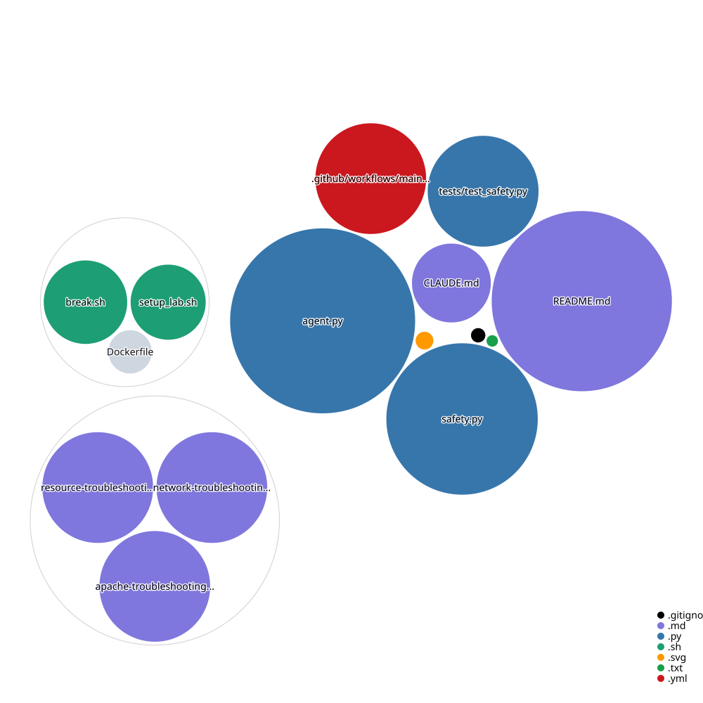
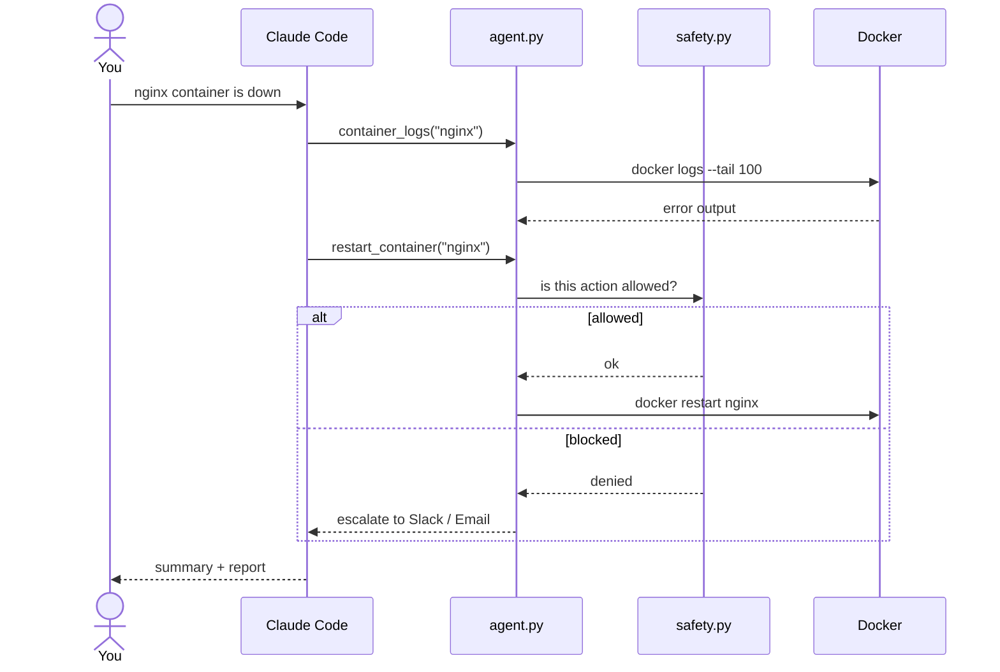

# Linux Server Troubleshoot Agent

A **read-only AI agent** that diagnoses Linux server problems using the [Claude Agent SDK](https://code.claude.com/docs/en/agent-sdk/overview).
It investigates a server with safe, allow-listed commands, finds the root cause, and suggests a fix for a **human** to apply.

> **v1 scope:** Apache web server issues on an Ubuntu 22.04 server running in Docker.

---

## How it works

```
Symptom ("apache2 is down")
        │
        ▼
 Claude agent ──plans──► Bash tool call, e.g. "docker exec lab-server apachectl -t"
        ▲                         │
        │              PreToolUse hook → safety.py (deny by default)
        │                 allowed? ── no ──► blocked; reason sent back to the agent
        │                         │ yes
        └── reads output ◄── command runs inside the lab container
        │
        ▼
 Report: Symptom · Evidence · Root cause · Fix · Verify   →  reports/*.md
```

The agent **never changes the server**. It only reads, then recommends.

---

## Features

- **Deny-by-default guardrail**: only read-only `docker` commands against `lab-server` are allowed; pipes, redirects, chaining and destructive commands are blocked.
- **Two tools only**: `Bash` and `Skill`; every call is checked by a `PreToolUse` hook, and only the project's own skills are allowed.
- **Cost and loop limits**: per-run budget cap (`max_budget_usd`) and turn limit (`max_turns`).
- **Audit log**: every command (allowed or blocked) is recorded in `audit.jsonl`.
- **Saved reports**: each successful run writes a Markdown report to `reports/`.
- **Skills (runbooks)**: Apache, resource (CPU/RAM/load) and network (curl, wget, netstat, ss) runbooks in `.claude/skills/`, loaded only when relevant.
- **Human-curated memory**: `CLAUDE.md` holds verified known issues and is loaded on every run; auto memory is disabled.
- **Reproducible failure lab**: scripts build a healthy server and inject known faults.
- **Watchdog**: a cron-friendly health check that runs the agent only when the site fails.
- **Unit-tested guardrail**: 34 tests prove safe commands pass and dangerous ones are blocked.

---

## Project structure

```
.
├── agent.py            # The agent: model, tool, hooks, limits, audit log, report saving
├── safety.py           # Command allow-list (the guardrail)
├── CLAUDE.md           # Environment facts + verified incidents, loaded into every run
├── .claude/skills/
│   ├── apache-troubleshooting/SKILL.md
│   ├── resource-troubleshooting/SKILL.md
│   └── network-troubleshooting/SKILL.md
├── watchdog.sh         # Health check that triggers the agent on failure
├── requirements.txt
├── .env.example        # Configuration template (copy to .env)
├── lab/
│   ├── Dockerfile      # Ubuntu 22.04 + Apache "server"
│   ├── setup_lab.sh    # Build and start a healthy lab-server
│   └── break.sh        # Reset the lab, then inject one fault
└── tests/
    └── test_safety.py  # Guardrail unit tests
```

Generated at runtime (git-ignored): `audit.jsonl`, `reports/`, `watchdog.log`.

---

## Prerequisites

- Ubuntu 22.04 (or similar Linux)
- Python 3.10+
- Docker, with your user in the `docker` group
- A Claude API key from the [Claude Console](https://console.anthropic.com/) (set a monthly spend limit there)

---

## Setup

```bash
# 1. Clone and enter the project
git clone <your-repo-url> && cd <repo-folder>

# 2. Python environment
python3 -m venv .venv
source .venv/bin/activate
pip install -r requirements.txt

# 3. Configuration
cp .env.example .env
nano .env                      # set ANTHROPIC_API_KEY
set -a && source .env && set +a

# 4. Verify the guardrail
pytest -q                      # expect: 34 passed

# 5. Start a healthy lab
chmod +x lab/*.sh watchdog.sh
./lab/setup_lab.sh             # expect: lab-server healthy (HTTP 200)
```

The site is published on the host at **http://localhost:8080** (bound to `127.0.0.1` only).

---

## Usage

### 1. Break the lab

```bash
./lab/break.sh bad-config
```

The script prints a **symptom** only. It does not reveal the cause.

### 2. Run the agent with that symptom

```bash
python agent.py "apache2 is down on lab-server and does not come back."
```

### 3. Read the result

- The **FINAL REPORT** is printed at the end of the run.
- It is saved to `reports/report-<timestamp>.md`.
- Every command the agent tried is in `audit.jsonl`:

```bash
python3 -m json.tool --json-lines audit.jsonl
```

### 4. Apply the fix yourself

The agent is read-only. Review the **Fix** section, run the commands, then run the **Verify** commands.

---

## Failure scenarios

| Scenario | Symptom given to the agent | Root cause to find |
|---|---|---|
| `bad-config` | apache2 is down and does not come back | Invalid line in `/etc/apache2/apache2.conf` |
| `permissions` | Website returns an error instead of the home page | `index.html` has mode `000` (HTTP 403) |
| `port-conflict` | apache2 will not start, but something answers on port 80 | Another process (`nc`) holds port 80 |
| `wrong-root` | Website returns "not found" | `DocumentRoot` points to a missing folder (HTTP 404) |
| `high-cpu` | Website is very slow, server overloaded | Busy-loop processes using all CPU |
| `high-memory` | Server running low on memory | One process holding ~300 MB RAM |
| *(manual)* `docker stop lab-server` | Website does not respond at all | Container exited; Apache must be started after `docker start` |

`setup_lab.sh` refuses to report healthy unless Apache returns **HTTP 200**, and `break.sh` will not inject a fault into an already-broken lab.

---

## Configuration

Set in `.env` (all optional except the API key):

| Variable | Default | Purpose |
|---|---|---|
| `ANTHROPIC_API_KEY` | (none) | Claude API key. **Required. Never commit it.** |
| `AGENT_MODEL` | `claude-sonnet-5-5` | Model for the agent (e.g. `claude-haiku-5-5` for lower cost) |
| `AGENT_MAX_TURNS` | `25` | Maximum agent steps per run |
| `AGENT_MAX_BUDGET_USD` | `0.50` | Hard cost cap per run |

Override for a single run:

```bash
AGENT_MODEL=claude-haiku-5-5 python agent.py "..."
```

---

## Memory (`CLAUDE.md`)

`CLAUDE.md` is the agent's long-term knowledge: environment facts and **human-verified** past incidents.
It is loaded at the start of every run (`setting_sources=["project"]`). The agent cannot write to it, and auto memory is disabled.

To add knowledge:

1. Verify the root cause yourself.
2. Add a short entry: symptom → first check → cause seen before → fix.
3. Write general guidance, not fixed answers.
4. Re-run the scenarios to confirm nothing got worse.

Keep it under ~200 lines: it is sent on every run, so every line costs tokens.

---

## Skills (runbooks)

Skills are step-by-step runbooks in `.claude/skills/<name>/SKILL.md`. Unlike `CLAUDE.md`, a skill is loaded **only when the agent needs it**, so detailed checks do not cost tokens on every run.

| Skill | Used for |
|---|---|
| `apache-troubleshooting` | Apache down, config errors, HTTP 403/404/5xx |
| `resource-troubleshooting` | Slow or overloaded server, high CPU, low memory |
| `network-troubleshooting` | curl, wget, netstat, ss; no response, timeouts, port problems |

At startup the agent prints `Skills loaded: [...]` and warns if any are missing.
Only reviewed skills listed in `SKILLS` in `agent.py` can load. Never add skills that use `` !`command` `` dynamic context.

## Watchdog (unattended checks)

`watchdog.sh` runs a free `curl` health check. It starts the agent **only** when the site fails, at most once per incident (30-minute cooldown), and never in parallel.

```bash
./watchdog.sh                  # run once manually
crontab -e                     # schedule every minute (as a normal user, not root):
# * * * * * /full/path/to/watchdog.sh
tail -f watchdog.log
```

| Variable | Default |
|---|---|
| `WATCHDOG_URL` | `http://localhost:8080` |
| `WATCHDOG_COOLDOWN_MIN` | `30` |

---

## Security model

| Control | Where |
|---|---|
| Only `Bash` and `Skill` tools are available | `tools=["Bash", "Skill"]` in `agent.py` |
| Only the project's 3 reviewed skills can load | `skills=SKILLS` + hook check |
| Every tool call checked before it runs, deny by default | `PreToolUse` hook → `safety.py` |
| Only read-only commands inside `lab-server` | `safety.py` allow-list |
| No pipes, redirects, chaining, substitution or globs | `safety.py` |
| Cost and loop limits | `max_budget_usd`, `max_turns` |
| Full audit trail | `audit.jsonl` |
| Human applies every fix | Read-only design |

**Important notes**

- Membership in the `docker` group is equivalent to root on the host. The guardrail is what keeps the agent safe: keep `safety.py` strict and run `pytest` after every change.
- The system prompt is **not** a security control. Enforcement lives in code (the hook).
- Server output (logs, config) is untrusted and may contain prompt-injection text. The allow-list blocks any resulting action.
- Do not run the agent as `root`. Never use `permission_mode="bypassPermissions"`.
- Never commit `.env`. Check `git status` before every push.

---

## Limitations

- Read-only: it diagnoses but does not fix.
- v1 covers Apache scenarios in a Docker lab only.
- It does not learn on its own; it improves only when `CLAUDE.md`, the prompt or the tools are improved.
- Model output can vary between runs; validate with repeated runs.
- `total_cost_usd` is a client-side estimate, not a billing statement.

---

## Roadmap

- [ ] `eval.py`: run every scenario automatically and score root-cause accuracy, turns and cost
- [ ] `container-stopped` scenario and read-only `docker ps -a` / `docker events`
- [ ] `--resume` to continue an earlier investigation
- [ ] `PostToolUse` hook: secret redaction, output truncation, prompt-injection flagging
- [ ] Haiku collector subagent + Sonnet analyst
- [ ] Structured (Pydantic) report output
- [ ] Notifications (Telegram / Slack / email)
- [ ] Fix-with-approval mode (human approves each action)
- [ ] More Linux scenarios: disk full, failed services, DNS, memory

---


## License

Add a license of your choice (for example, MIT).
